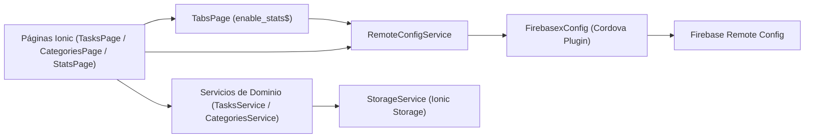

<div align="center">

# DoneWell

**Aplicación móvil híbrida para gestión de tareas, categorías personalizadas y control remoto de funcionalidades**

<p>
  
  
  
  
</p>
<p>
  
  
  
</p>

<p>
  <a href="https://github.com/JaRodriguez97/done-well/releases">
    
  </a>
</p>

<p>
  <a href="#funcionalidades-principales">Funcionalidades</a> •
  <a href="#paleta-visual-midnight-violet">Paleta Visual</a> •
  <a href="#arquitectura">Arquitectura</a> •
  <a href="#requisitos-del-entorno">Requisitos</a> •
  <a href="#instalación-y-pruebas">Ejecución Web</a> •
  <a href="#firebase-remote-config">Firebase</a> •
  <a href="#compilación-android-y-apk">Compilar APK</a>
</p>

</div>

---

## Funcionalidades Principales

<table>
  <tr>
    <td width="50%" valign="top">
      <h3>✅ Gestión de Tareas (CRUD)</h3>
      Creación mediante modal (<code>IonModal</code>), cambio rápido de estado (completada / pendiente), asignación opcional de categoría y eliminación segura con alerta de confirmación (<code>AlertController</code>).
    </td>
    <td width="50%" valign="top">
      <h3>🏷️ Categorías Personalizadas</h3>
      Creación, edición y eliminación en modal con selector de <strong>24 íconos Ionicons</strong> y <strong>6 colores semánticos</strong>. Al eliminar una categoría, las tareas asociadas se desvinculan sin perderse.
    </td>
  </tr>
  <tr>
    <td width="50%" valign="top">
      <h3>🎚️ Slider Horizontal de Filtros</h3>
      Barra horizontal deslizable con chips para filtrar tareas por <code>Todas</code>, <code>Sin categoría</code> o cualquier categoría creada, mostrando contadores actualizados en tiempo real.
    </td>
    <td width="50%" valign="top">
      <h3>💾 Persistencia Local Offline</h3>
      Almacenamiento persistente entre sesiones con <code>@ionic/storage-angular</code> encapsulado en <code>StorageService</code>, conservando tareas y categorías al cerrar la aplicación.
    </td>
  </tr>
  <tr>
    <td width="50%" valign="top">
      <h3>📊 Estadísticas & Remote Config</h3>
      Pestaña <strong>Estadísticas</strong> controlada en vivo mediante el parámetro booleano <code>enable_stats</code> en Firebase Remote Config: se actualiza al iniciar, al volver de segundo plano (<code>platform.resume</code>) y con botón manual.
    </td>
    <td width="50%" valign="top">
      <h3>🌌 Diseño Dark Premium</h3>
      Construida 100% con componentes nativos de <code>@ionic/angular/standalone</code>, tokens CSS globales, soporte <code>safe-area</code>, superficies <em>glassmorphism</em> y áreas táctiles mínimas de <code>44px</code>.
    </td>
  </tr>
</table>

---

## Paleta Visual (_Midnight Violet_)

El sistema visual define los colores de interfaz y categorías como tokens CSS globales en [`src/theme/variables.scss`](src/theme/variables.scss), reservando el color de categoría para acentos laterales de `4px`, chips e íconos:

| Rol Visual                    | Token CSS                | Hexadecimal |                                     Muestra                                     |
| :---------------------------- | :----------------------- | :---------: | :-----------------------------------------------------------------------------: |
| Fondo Nocturno Base           | `--ion-background-color` |  `#0B1020`  |  |
| Superficie / Tarjetas         | `--dw-surface-dark`      |  `#151B30`  |  |
| Primario / **Trabajo**        | `--color-trabajo`        |  `#7567F8`  |  |
| Acento Secundario             | `--ion-color-secondary`  |  `#A99EFF`  |  |
| Categoría **Personal**        | `--color-personal`       |  `#40E0D0`  |  |
| Categoría **Estudios**        | `--color-estudios`       |  `#6798FF`  |  |
| Categoría **Compras**         | `--color-compras`        |  `#FFCC00`  |  |
| Categoría **Urgente** / Error | `--color-urgente`        |  `#FF7660`  |  |
| Categoría **Otros**           | `--color-otros`          |  `#667499`  |  |

---

## Arquitectura



<details open>
<summary>📂 <strong>Ver estructura de carpetas del proyecto (<code>src/app/</code>)</strong></summary>

```text
src/app/
├── core/
│   ├── constants/       # Claves de Storage, Remote Config y catálogo de íconos/colores
│   ├── models/          # Entidades POO (BaseEntity, TaskItem, CategoryItem) y contratos TS
│   └── services/        # Servicios transversales (StorageService, RemoteConfigService)
├── features/
│   ├── tasks/           # Vista de tareas, modal de creación, slider horizontal y TasksService
│   ├── categories/      # Vista de categorías, modal/formulario y CategoriesService
│   └── stats/           # Vista de estadísticas de progreso general y por categoría
└── tabs/                # Barra de navegación inferior reactiva al flag enable_stats
```

</details>

---

## Requisitos del Entorno

| Herramienta         | Versión                         | Uso principal                                             |
| :------------------ | :------------------------------ | :-------------------------------------------------------- |
| **Node.js**         | `v20.x` (`>= 20.20.0`)           | Entorno de ejecución compatible con Cordova 14            |
| **Angular**         | `17.3.x`                        | Framework base con componentes Standalone                 |
| **Ionic Angular**   | `8.0.x`                         | Componentes UI móviles nativos                            |
| **Cordova CLI**     | `13.x`                          | Empaquetado híbrido multiplataforma                       |
| **Cordova Android** | `14.0.0`                        | Plataforma nativa Android                                 |
| **Java JDK**        | `11+`                           | Compilación Gradle (compatible con JBR de Android Studio) |
| **Android SDK**     | API `35` / Build-Tools `35.0.0` | Target SDK requerido por `cordova-android@14`             |
| **Gradle**          | `8.x`                           | Sistema de construcción Android                           |

---

## Instalación y Pruebas

```bash
# 1. Instalar dependencias del proyecto
npm install

# 2. Levantar el servidor de desarrollo en el navegador
ionic serve
```

> [!TIP]
> También puedes usar `npm start` para iniciar directamente con Angular CLI.

```bash
# Validar reglas de ESLint (TypeScript + plantillas HTML)
npm run lint

# Ejecutar suite de pruebas unitarias (Jasmine + Karma)
ng test --watch=false --browsers=ChromeHeadless

# Compilar bundle web de producción
npm run build
```

---

## Firebase Remote Config

> [!IMPORTANT]
> Por seguridad, `google-services.json` está excluido en [`.gitignore`](.gitignore) para no exponer claves de API en el repositorio público. Usa [`google-services.example.json`](google-services.example.json) como referencia estructural.

1. Crea un proyecto en [Firebase Console](https://console.firebase.google.com/) y registra una app **Android** con el _package name_ exacto definido en [`config.xml`](config.xml):
   ```text
   com.donewell.app
   ```
2. Descarga `google-services.json` desde Firebase y guárdalo en la raíz del proyecto (`done-well/google-services.json`, junto a `config.xml`).
3. En **Firebase Console → Ejecución (Run) → Remote Config**, crea el parámetro y pulsa **Publicar cambios**:
   - **Clave:** `enable_stats`
   - **Tipo:** `Boolean`
   - **Valor predeterminado:** `true` _(visible)_ / `false` _(oculta la pestaña en vivo y redirige a Tareas)_

> [!NOTE]
> Cuando la aplicación corre en navegador web o sin el plugin nativo disponible, `RemoteConfigService` aplica de forma segura el valor inicial definido en [`remote-config.constants.ts`](src/app/core/constants/remote-config.constants.ts).

---

## Compilación Android y APK

<details>
<summary>⚙️ <strong>Recordatorio de variables de entorno en Windows (PowerShell)</strong></summary>

```powershell
$env:JAVA_HOME = "C:\Program Files\Android\Android Studio\jbr"
$env:ANDROID_HOME = "$env:LOCALAPPDATA\Android\Sdk"
$env:ANDROID_SDK_ROOT = "$env:LOCALAPPDATA\Android\Sdk"
$env:PATH = "$env:JAVA_HOME\bin;$env:ANDROID_HOME\cmdline-tools\latest\bin;$env:ANDROID_HOME\platform-tools;D:\gradle-8.14.3\bin;$env:PATH"
```

</details>

```bash
# 1. Agregar la plataforma Android (si acabas de clonar el repositorio)
ionic cordova platform add android@14.0.0

# 2. Verificar que JDK, Android SDK y Gradle cumplan los requisitos
ionic cordova requirements android

# 3. Sincronizar recursos y copiar google-services.json hacia Android
ionic cordova prepare android

# 4. Compilar y generar el archivo APK
ionic cordova build android

# 5. Instalar y ejecutar directamente en un dispositivo conectado por USB
ionic cordova run android --device
```

> [!TIP]
> **Ubicación del APK generado:** `platforms/android/app/build/outputs/apk/debug/app-debug.apk`

---

## Entregables y Descarga del APK

- **APK compilado listo para instalar:** Disponible en [**GitHub Releases**](https://github.com/JaRodriguez97/done-well/releases).
- **Evidencias funcionales:** Incluyen creación, completado y eliminación de tareas; gestión completa de categorías; filtrado por slider horizontal; persistencia local tras reiniciar la app; y demostración en vivo del _feature flag_ `enable_stats` en Firebase Remote Config.
